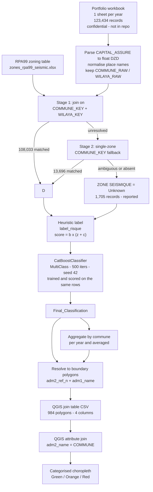
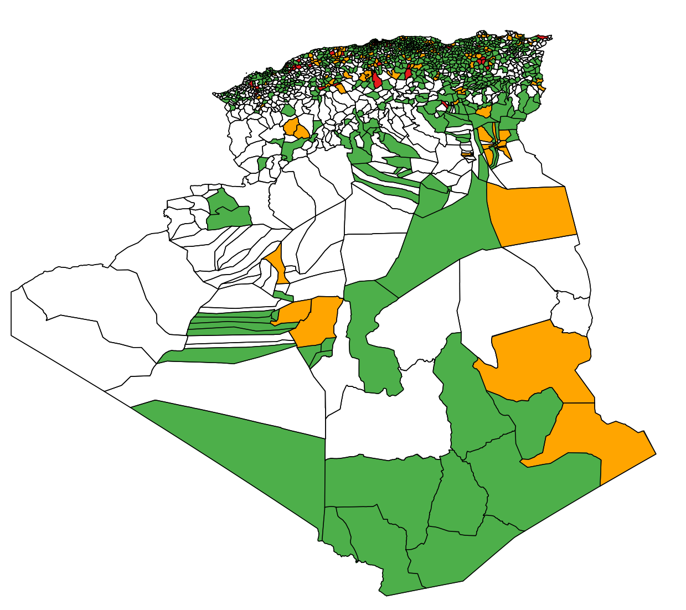

# Algeria Seismic Risk Assessment & Geospatial Mapping

A data-engineering pipeline that joins an Algerian insurance portfolio to the national **RPA99** seismic zoning, classifies each record into a three-level risk class, aggregates the result to commune level, and exports a QGIS-ready table driving a national risk map.

Built as deliverable B of the GAM Assurance hackathon: seismic risk classification of a national property portfolio, combining geospatial data engineering with applied machine learning.

       

| At a glance | |
|---|---|
| **Hazard standard** | RPA99 / DTR E.S. 1-2-2008 — 5 zones (`0`, `I`, `IIa`, `IIb`, `III`) at commune level |
| **Records processed** | **123,434** insurance records, 2023–2025 |
| **Seismic-zone matching** | **98.62%** (121,729) via a two-stage ambiguity-safe join |
| **Risk classes** | Red / Orange / Green, from a documented expert rule + CatBoost |
| **QGIS polygons exported** | **984** of 1,541 admin-2 communes — 100% exact name match |
| **Stack** | Python · pandas · NumPy · CatBoost · pyshp · QGIS |
| **Confidential input** | Portfolio is private and **not** in this repository |

Full method, verified figures and limitations below. The classifier is a **heuristic rule plus a learned surrogate** — see [Machine Learning Limitations](#10-machine-learning-limitations) before quoting any performance claim.

---

## 1. Overview

### The problem

Algeria sits in one of the most seismically active regions of the Mediterranean. The national building regulation **RPA99 / DTR E.S. 1-2-2008** divides the territory into seismic hazard zones (`0`, `I`, `IIa`, `IIb`, `III`, with `III` the most severe) at commune level. An insurer accumulating property policies commune by commune needs to know where exposure sits relative to hazard, whether value is concentrated in a few urban communes, and how to communicate any of it to a risk committee.

The hard part is not the scoring. It is that **the portfolio and the zoning table do not share a naming convention**. The portfolio stores commune names as free text, often as a composite `"COMMUNE WILAYA"` string, with inconsistent accents, abbreviations and casing. The RPA99 annex and the GADM boundary layer each spell the same places differently. A naive join on raw strings silently mis-assigns hazard — the most dangerous failure mode in a risk model, because it looks like it worked.

### What the pipeline does

The pipeline normalises every place name into a canonical key while **preserving the raw source value**, associates each record with an RPA99 zone through a two-stage ambiguity-safe join, derives a heuristic risk label and trains a CatBoost classifier on those labels, then aggregates to commune level and exports a table keyed on the boundary layer's own names so the QGIS join matches by construction.

Every decision in the matching stage serves one goal: **refusing to guess**. Giving a record that is really in Zone `III` (Alger) the Zone `0` (Sahara) weight produces no visible error — it produces a plausible-looking number. Where a commune is ambiguous across wilayas and the wilaya field does not disambiguate it, the record is marked `Unknown` and reported, rather than assigned to whichever row came first.

---

## 2. Key Features

- **Multi-year ingestion** — one worksheet per year, tagged `Source_Year`; new years need no code change.
- **Place-name normalisation** — accent and case folding, punctuation collapsing, trailing-wilaya stripping. Raw values retained in `COMMUNE_RAW` / `WILAYA_RAW`.
- **Two-stage ambiguity-safe seismic join** — strict `(COMMUNE_KEY, WILAYA_KEY)`, then a single-zone commune fallback accepted only when the commune resolves to exactly one zone. **Row order is never a tie-breaker.**
- **Explicit rejection of ambiguity** — 29 commune names span several zones in the annex; those are withheld as `Unknown`.
- **Transparent expert risk rule** — `score = b × (z + c)` over seismic zone, insured capital and construction type, weights documented in the source.
- **CatBoost multiclass classifier** — 5 categorical + 1 numeric feature, native categorical handling, seeded (`random_seed=42`).
- **Three aggregation levels** — record, commune × year, and commune averaged across the window.
- **Boundary-authoritative QGIS export** — reads `adm2_name` from the shapefile and writes those exact strings, for a verified 100% join match.
- **Reproducible output** — identical SHA-256 across independent runs.
- **Data-quality reporting** — two audit CSVs listing every unresolved commune with its reason and row count.
- **Confidentiality by construction** — no policy-level data is published.

---

## 3. Architecture / Workflow



### The risk rule as implemented

Every record receives a label from a documented expert score. There is no observed loss data in the portfolio, so labels are **constructed, not measured**:

| Component | Source | Values |
|---|---|---|
| `b` — fragility factor | `TYPE` | Industrial `4.0` · Commercial `2.5` · otherwise `1.0` |
| `z` — hazard weight | `ZONE SEISMIQUE` | `III` 10 · `IIb` 7 · `IIa` 5 · `I` 2 · `0`/`Unknown` 0 |
| `c` — exposure weight | `log10(CAPITAL_ASSURE)` | ≥8.5 → 10 · ≥7.5 → 7 · ≥6.5 → 5 · ≥5.5 → 3 · else 0 |

`score = b × (z + c)`, then `≥ 11` → **Red**, `≥ 6` → **Orange**, else **Green**.

Capital is bucketed on a `log10` scale because the distribution is heavily right-skewed: the mean is 7,155,131 DZD but the median is 2,500,000 DZD and the maximum is 15,500,000,000 DZD. On a linear scale a single industrial policy would dominate every other feature. `log10(0)` is guarded to avoid `-inf`.

Full rationale, weights and caveats: [`docs/METHODOLOGY.md`](docs/METHODOLOGY.md).

---

## 4. Repository Structure

```text
.
├── README.md
├── LICENSE                                  MIT (see scope note)
├── requirements.txt
├── .gitignore                               blocks confidential data + generated artefacts
│
├── RisquePredictionCatBoost.py              superseded first iteration, kept for provenance
│
├── RisquePredictionCatBoost/                pipeline folder
│   └── RisquePredictionCatBoost/
│       ├── RisquePredictionCatBoost.py      MAIN ENTRY POINT
│       ├── zones_rpa99_seismic.xlsx          RPA99 commune to hazard zone (public)
│       ├── outputs/
│       │   ├── Algeria_Seismic_Risk_Classified.xlsx        row-level - IGNORED
│       │   ├── Algeria_Seismic_Risk_By_Year.xlsx           commune x year
│       │   ├── Algeria_Seismic_Summary_for_QGIS.xlsx       commune, averaged
│       │   ├── Algeria_Seismic_Summary_for_QGIS_Mapped.csv QGIS join table, 984 rows
│       │   ├── qgis_unmapped_communes.csv                  diagnostic
│       │   ├── unmatched_communes_report.csv               diagnostic
│       │   └── catboost_info/                              training logs - IGNORED
│       └── CATNAT_2023_2025(1).xlsx          confidential input - IGNORED
│
├── QGis_files/
│   ├── Cartographie_du_risque.qgz           QGIS project
│   ├── Algeria_Seismic_Summary_for_QGIS.xlsx
│   ├── Algeria_Seismic_Summary_for_QGIS_Mapped.csv   stale 1,010-row table
│   ├── commune_level_aggregated_corrected_dbf_fixed.csv
│   ├── zones_rpa99_final.csv
│   └── dza_admin_boundaries.shp/            GADM-derived, WGS84
│       ├── dza_admin0.*      (1 polygon)    country outline
│       ├── dza_admin1.*      (48)           wilayas
│       ├── dza_admin2.*      (1,541)        communes - authoritative join names
│       ├── dza_adminlines.*  (4,762)        internal boundaries
│       └── dza_adminpoints.* (1,589)        label points
│
├── docs/
│   ├── METHODOLOGY.md                       method, weights, limitations
│   ├── DATA_DICTIONARY.md                   every column defined
│   ├── DATA_SOURCES.md                      provenance, licensing, confidentiality
│   ├── GAM_Hackathon_Brief_and_Student_Guide.pdf
│   ├── GAM_Seismic_Risk_and_Portfolio_Report.pdf
│   ├── RPA99_Seismic_Classification_by_Wilaya.pdf
│   └── RPA99_Confined_Masonry_Design.pdf
│
├── zones_rpa99_final.csv                    zoning tables, CSV copies for provenance
├── zones_rpa99_with_source.csv
├── CATNAT_2023_2025.xlsx                    confidential - IGNORED
└── CATNAT_2023_2025_with_zones.xlsx         confidential - IGNORED
```

**Intentionally excluded by `.gitignore`:** the raw portfolio (`CATNAT_2023_2025*.xlsx`), the row-level classified output (`Algeria_Seismic_Risk_Classified.xlsx` — one row per policy, so it reproduces the raw file), any `*_policies.csv` dump, CatBoost artefacts (`catboost_info/`, `*.cbm`), and editor/QGIS runtime files.

---

## 5. Methodology

### Data preparation

`CAPITAL_ASSURE` arrives as text in French/Algerian format — space thousands separators and a comma decimal mark (`"2 500,000"`). It is stripped, separators normalised, and cast to `float64`.

Place names are normalised into separate `COMMUNE_KEY` and `WILAYA_KEY` columns. The GAM `COMMUNE` field is a composite `"COMMUNE WILAYA"` string, so `_strip_wilaya_suffix()` removes a trailing token that duplicates the `WILAYA` column, and a wilaya alias map handles forms such as `B B ARRERIDJ`. Originals are preserved in `COMMUNE_RAW` / `WILAYA_RAW` and appear in the diagnostic reports, so every match traces back to what the source actually said.

### Seismic matching

The join is deliberately two-stage and never order-dependent:

1. **Stage 1** — match on the normalised pair `(COMMUNE_KEY, WILAYA_KEY)`. Resolved **108,033** records.
2. **Stage 2** — retry unresolved records on `COMMUNE_KEY` alone, but **only accept a commune mapping to exactly one zone** in the annex. Resolved a further **13,696**.
3. **Rejection** — where the annex splits a commune name across several zones (29 names, including `AIN BENIAN`, `BESBES`, `CHERAGA`, `SIDI AMAR`, `SOUK EL HAD`) and the wilaya does not disambiguate, the zone is **withheld**. Names absent from the annex are unmatched.
4. **Fallback value** — anything unresolved becomes `ZONE SEISMIQUE = 'Unknown'`, never a default zone.

**Final coverage: 121,729 / 123,434 = 98.62% matched. 1,705 records (1.38%) remain `Unknown` — 35 withheld as ambiguous, 1,670 unmatched.** The pipeline does not claim 100% coverage, and the residual is published rather than hidden.

---

## 6. Risk Classification

Three distinct things happen here, and they should not be conflated:

**a. Deterministic business rule (`label_risque`).** A transparent expert score over seismic zone, log-bucketed insured capital and construction fragility — fully inspectable, with the weights written out in the source. This is what makes the project auditable.

**b. Machine-learning component (CatBoost).** A `MultiClass` classifier, 500 iterations, `random_seed=42`, trained on `COMMUNE`, `WILAYA`, `ZONE SEISMIQUE`, `TYPE` and `Source_Year` as native categoricals, plus `CAPITAL_ASSURE` numeric. CatBoost was specified over Random Forest because the commune feature alone carries roughly 1,500 distinct values, which ordered target statistics handle without encoding.

**c. Final classification.** `Final_Classification` is the CatBoost prediction and drives the aggregation and the map. The heuristic labels are the model's *training target*, not ground truth.

> **The model is currently trained and evaluated on the same rows.** Agreement between `Final_Classification` and `Risque_Color` measures how well CatBoost reproduced the heuristic — it says nothing about generalisation to unseen data. No accuracy, precision or recall figure is claimed anywhere in this repository, because none would be meaningful yet. See [Machine Learning Limitations](#10-machine-learning-limitations).

---

## 7. Results

All figures come from a verified end-to-end run on the full portfolio.

| Metric | Result |
|---|---:|
| Portfolio records processed | 123,434 |
| Stage 1 — matched on commune + wilaya | 108,033 |
| Stage 2 — matched on single-zone commune | 13,696 |
| **Total matched to a seismic zone** | **121,729 (98.62%)** |
| Left as `Unknown` | 1,705 (1.38%) |
| — withheld as ambiguous / unmatched | 35 / 1,670 |
| Distinct unresolved commune names | 37 (across 67 key combinations) |
| Total insured capital | 883.19 bn DZD |
| Mean / median capital per record | 7,155,131 / 2,500,000 DZD |
| Distinct commune × wilaya groups | 1,537 |

### Exposure by seismic zone

| Zone | Records | Share | Capital (bn DZD) | Capital share |
|---|---:|---:|---:|---:|
| `IIa` | 68,373 | 55.4% | 445.86 | 50.48% |
| `III` | 37,497 | 30.4% | 293.18 | 33.20% |
| `I` | 9,105 | 7.4% | 66.99 | 7.58% |
| `IIb` | 3,500 | 2.8% | 31.42 | 3.56% |
| `0` | 3,254 | 2.6% | 22.41 | 2.54% |
| `Unknown` | 1,705 | 1.4% | 23.33 | 2.64% |

Roughly a third of insured capital — 293.18 bn DZD — sits in Zone `III`, the highest-hazard zone, while representing 30.4% of records.

### Final classification counts

| Risk class | Records | Share | Capital (bn DZD) | Capital share |
|---|---:|---:|---:|---:|
| Red | 55,519 | 45.0% | 665.04 | 75.30% |
| Orange | 57,753 | 46.8% | 192.39 | 21.78% |
| Green | 10,162 | 8.2% | 25.75 | 2.92% |

> **These are classification counts, not accuracy metrics.** They describe how many portfolio records fall into each class — not how well the model performs.

Three quarters of insured value lands in Red while record counts are nearly even, a direct consequence of log-bucketing capital: many moderate policies, very few enormous ones.

### QGIS export

| Metric | Result |
|---|---:|
| Administrative polygons exported | 984 |
| Columns | `COMMUNE`, `TOTAL_CAPITAL`, `DOMINANT_RISK`, `POLICY_COUNT` |
| Exact match against boundary `adm2_name` | **100.00% (984 / 984)** |
| Duplicate `COMMUNE` values | 0 |
| Records represented | 121,726 of 123,434 |
| Red / Orange / Green polygons | 323 / 521 / 140 |
| Polygons with no portfolio data | 557 |
| Reproducibility | identical SHA-256 across two runs |

---

## 8. QGIS Visualization



The map is rendered by QGIS Desktop, not by the pipeline. The Python side produces a four-column table; the `.qgz` project does the cartography.

### How the export is generated

The project joins the boundary layer to a CSV on **`adm2_name = COMMUNE`**. Those fields come from different organisations — GADM and the RPA99 annex — and do not agree on spelling. Writing the portfolio's own commune strings into `COMMUNE` would have left the join silently empty.

The pipeline therefore treats **`dza_admin2.shp` as the authoritative naming source**: it reads `adm2_ref_n` (the bare commune stem) and `adm1_name` (the wilaya) to resolve each portfolio commune to a polygon, then writes that polygon's own `adm2_name` verbatim. The join then matches by construction.

Two different duplicate problems, handled differently:

- **National duplicates** — 40 commune stems exist in more than one wilaya (`AIN TURK` is in Oran, Bouira and El Tarf; `CHERAGA` in Alger and Mila). Resolved by matching the wilaya too, accepted only when exactly one polygon survives.
- **Portfolio-internal duplicates** — GAM often stores the wilaya inside `COMMUNE`, so one real commune appears under several GAM names. Where several GAM groups resolve to the same polygon they are **aggregated into one row**, which is why 1,537 groups collapse to 984 polygons.

Where neither route is safe the group is excluded and listed in `outputs/qgis_unmapped_communes.csv`.

This cartographic residual is **1,708 policies, not the 1,705 seismic records** — the two measure different things over the same 67 unresolved commune keys. The gap of 3 is one key: three `AIN TURK` records with no wilaya field. They resolve to Zone `IIa` through the seismic annex, so they are not part of the 1,705, but `AIN TURK` exists in three wilayas in the boundary layer and nothing is available to disambiguate it, so no polygon can be chosen.

### Opening the map

QGIS Desktop → **Project ▸ Open** → `QGis_files/Cartographie_du_risque.qgz`. Layer sources are relative, so keep the project inside the repository folder structure.

**The committed project is preserved as-is.** `Cartographie_du_risque.qgz` and the legacy `QGis_files/Algeria_Seismic_Summary_for_QGIS_Mapped.csv` (1,010 rows, from the first iteration) were deliberately left untouched when the export was built and validated — the pipeline never writes into `QGis_files/`, and the new table was verified against a **temporary copy** of the project so the original was never modified.

Because the project's datasource is hard-wired to that filename, showing fresh results is a deliberate **local** step. Either:

1. **Copy the generated file** — `outputs/Algeria_Seismic_Summary_for_QGIS_Mapped.csv` over the project's source location, understanding you are then editing a tracked file locally; or
2. **Repoint a local copy of the project** — copy the `.qgz` (and its folder) elsewhere, then in QGIS use **Layer ▸ Properties ▸ Source** to select the CSV under `outputs/`. This leaves the committed project untouched.

In both cases the schema must stay `COMMUNE, TOTAL_CAPITAL, DOMINANT_RISK, POLICY_COUNT` and the values must be the exact boundary `adm2_name` strings, because the renderer is categorised on `DOMINANT_RISK` and joined on `adm2_name = COMMUNE`.

### No-data areas

557 of the 1,541 polygons have no portfolio records and render as no-data.

> **White / no-data areas indicate that no portfolio records were available for those administrative polygons. They must not be interpreted as low seismic risk.** A commune with no insured property is an absence of exposure data, not an absence of hazard — much of the Algerian south is Zone `0`, and blank communes there are simply outside the book.

---

## 9. Data Quality & Limitations

Residual problems are **documented rather than silently corrected**, because a plausible-looking wrong hazard assignment is worse than a visible gap.

1. **1.38% of records have no seismic zone.** 1,705 are `Unknown`: 35 withheld as ambiguous, 1,670 unmatched. They are scored with `z = 0`, the same weight as Zone `0`, so they are **systematically under-classified** — a known bias, not a neutral gap.
2. **The GAM `COMMUNE` field is often malformed**, frequently a composite `"COMMUNE WILAYA"` string (`CHERAGA ALGER`, `ARZEW ORAN`, `BOUGARA BLIDA`, `SIDI AMAR SAIDA`). Stripping the token resolves many, but where it disagrees with the `WILAYA` column the record is left unresolved rather than picking a winner.
3. **`AIN` and `BEB EZZOUAR` are the two largest unresolved names** — 856 and 586 rows. `BEB EZZOUAR` is a district of Algiers rather than a standalone commune, and `AIN` is a bare fragment. Both need an upstream reference-data fix, not a matching tweak.
4. **Some records carry an incorrect wilaya.** Several unresolved pairs pair a commune with a wilaya that does not contain it (`BEB EZZOUAR` with `DJELFA`, `TIZI OUZOU` or `B B ARRERIDJ`). The pair join requires both keys to agree, so these match nothing. Retaining raw values makes the conflict auditable.
5. **6 stems remain ambiguous after the wilaya check** — `AIN TURK`, `AIN BENIAN`, `AIN SOLTANE`, `BESBES`, `OULED SIDI BRAHIM`, `SIDI LAKHDAR`. The GAM wilaya corresponds to no wilaya containing that commune name, so no safe choice exists.
6. **557 QGIS polygons have no data** and appear as no-data, not as low risk. See [No-data areas](#no-data-areas).
7. **Duplicate GAM `(COMMUNE, WILAYA)` groups can denote the same real polygon.** 1,072 of 1,537 groups hold more than one record, and several GAM names collapse onto one boundary polygon. The export aggregates rather than duplicating, so group and polygon counts are not comparable.
8. **Zone `0` and `Unknown` score identically** (`z = 0`), affecting 3,254 Sahara records and the 1,705 unresolved ones.

---

## 10. Machine Learning Limitations

This section is explicit because the most common way a project like this misleads is by quoting an agreement figure as an accuracy figure.

- **CatBoost is part of the current pipeline** and produces the `Final_Classification` that drives the map.
- **The current evaluation is not an independent predictive evaluation.** The model is fitted and scored on the same 123,434 rows.
- **Training and evaluating on the same data does not establish generalisation performance.** A high agreement figure measures how closely the model reproduced the heuristic that generated its labels — a consistency check, not evidence of predictive accuracy.
- **No accuracy score is claimed** for the CatBoost component anywhere in this repository, and none should be quoted from it.
- **The labels themselves are heuristic**, from `label_risque()` — not observed loss or damage data. The model is a learned surrogate for a business rule, not a discovery of risk from data.

A future version needs a **stratified train/test split or cross-validation**, reporting precision, recall, macro-F1 and a per-class confusion matrix — plus calibration measures if the intended use is ranking or pricing. Any such evaluation must also state whether it measures agreement with the heuristic or with an independent source of truth, because those are different claims.

---

## 11. Reproducibility

### Installation

```bash
git clone https://github.com/zaps-art/gam-seismic-risk.git
cd gam-seismic-risk

python -m venv .venv
# Windows
.venv\Scripts\activate
# macOS / Linux
source .venv/bin/activate

pip install -r requirements.txt
```

Verified combination: Python 3.13.14 · pandas 3.0.2 · NumPy 2.4.4 · CatBoost 1.2.10 · openpyxl 3.1.5 · pyshp 3.0.3. QGIS is **not** required to run the pipeline — only to open the map.

### Data availability

> **The insurance portfolio is confidential and is not in this repository.** It was supplied under confidentiality terms and contains policy-level records. `.gitignore` blocks it, along with any row-level derivative. Only commune-level aggregates are published. See [`docs/DATA_SOURCES.md`](docs/DATA_SOURCES.md).
>
> Everything else — including `zones_rpa99_seismic.xlsx`, derived from a published government annex — **is** included.

You must supply your own authorised copy. The script expects one worksheet per year and the column schema in [`docs/DATA_DICTIONARY.md`](docs/DATA_DICTIONARY.md).

### Run

```bash
python RisquePredictionCatBoost/RisquePredictionCatBoost/RisquePredictionCatBoost.py
```

Dropping a workbook named `CATNAT_2023_2025*.xlsx` next to the script is enough — the filename is auto-detected. To point elsewhere:

```bash
python RisquePredictionCatBoost/RisquePredictionCatBoost/RisquePredictionCatBoost.py \
    --portfolio /secure/path/CATNAT_2023_2025.xlsx
```

| Flag | Default | Purpose |
|---|---|---|
| `--portfolio` | `CATNAT_2023_2025_clean.xlsx`, else first `CATNAT_2023_2025*.xlsx` beside the script | confidential input workbook |
| `--zones` | `zones_rpa99_seismic.xlsx` beside the script | RPA99 commune → hazard zone table |
| `--outdir` | `outputs/` beside the script | destination for generated tables |
| `--boundaries` | `QGis_files/dza_admin_boundaries.shp/dza_admin2.shp` | source of the authoritative `adm2_name` values |
| `--skip-qgis-export` | off | build only the Excel tables; boundary layer not needed |
| `-h`, `--help` | — | usage |

The default boundary path resolves relative to the script, so it works from any working directory. For a different boundary source:

```bash
python RisquePredictionCatBoost/RisquePredictionCatBoost/RisquePredictionCatBoost.py \
    --boundaries /path/to/admin2.shp
```

Optional environment variables: `GAM_PORTFOLIO_FILE`, `GAM_ZONES_FILE`, `GAM_BOUNDARIES_FILE`. The corresponding flag always wins. The run is seeded (`random_seed=42`) and verified to produce a byte-identical export across independent runs.

---

## 12. Outputs

Written to `RisquePredictionCatBoost/RisquePredictionCatBoost/outputs/`:

| File | Contents | Status |
|---|---|---|
| `Algeria_Seismic_Summary_for_QGIS_Mapped.csv` | 984 boundary polygons, 4 columns, QGIS join table | aggregate, publishable |
| `Algeria_Seismic_Summary_for_QGIS.xlsx` | commune × wilaya, averaged capital and dominant risk | aggregate, publishable |
| `Algeria_Seismic_Risk_By_Year.xlsx` | commune × year breakdown | aggregate, publishable |
| `qgis_unmapped_communes.csv` | commune keys that could not be placed on a polygon | diagnostic |
| `unmatched_communes_report.csv` | seismic-zone residual with reasons and row counts | diagnostic |
| `Algeria_Seismic_Risk_Classified.xlsx` | **one row per policy** — reproduces the raw file | **confidential, git-ignored** |
| `catboost_info/` | training logs and loss curve | git-ignored |

The two diagnostic CSVs contain commune-level keys and row counts only — no policy numbers, capitals or premiums.

---

## 13. Security & Privacy

- The raw portfolio and every row-level derivative are excluded through `.gitignore`, which blocks `CATNAT_2023_2025*.xlsx`, `Algeria_Seismic_Risk_Classified.xlsx`, `*_policies.csv`, `*_policy_level.*` and CatBoost artefacts.
- **No policy-level data, customer information or personal information appears in this repository.** Published outputs are commune-level aggregates: counts, summed capital and a dominant risk class.
- The classified output is treated as confidential precisely because one row per policy reproduces the shape and scale of the source file.
- Users must supply their own authorised data; nothing here substitutes for the real portfolio.
- No credentials, API keys or secrets are stored — the only environment variables are local file paths.

---

## 14. Future Improvements

Not implemented, roughly ordered by value relative to effort.

1. **Stratified train/test split or cross-validation**, reporting a confusion matrix, macro-F1 and per-class precision/recall — what would turn the classifier from a demonstration into an evaluated component.
2. **Re-join on the official integer codes** (`commune_code`, `wilaya_code`) present in both datasets. These stable identifiers would eliminate most of the 1,705 unresolved records without any name matching.
3. **A commune alias reference table** for the `BEB EZZOUAR` / `AIN` fragment cases and wilaya abbreviations, validated against an official gazetteer.
4. **Separate Zone `0` from `Unknown`** in the scoring function, so unresolved records are not silently treated as low hazard.
5. **Automate the QGIS handoff** — publish the export and generate the map screenshot and a short report as part of the run.
6. **Persist the trained model** (`model.save_model(...)`) with a scoring script, so a new portfolio can be classified without retraining.
7. **Uncertainty reporting** — surface model confidence alongside the class, distinguishing "confidently Green" from "Green because the zone is missing".
8. **Monte Carlo loss simulation** — sample epicentres and magnitudes, apply a damage function per construction type, report a loss distribution and 99th-percentile PML. This converts the map into a number a reinsurance team can act on.
9. **Richer spatial analysis** — exposure weighted by building count and floor area rather than insured capital alone.
10. **Interactive web mapping** (Folium/Plotly) for stakeholders without QGIS, and **replace the GADM shapefiles** with an openly licensed source before wider distribution.

---

## 15. Technologies

Only what the project actually uses.

| Layer | Technology | Version | Role |
|---|---|---|---|
| Language | Python | 3.13.14 | everything |
| Data processing | pandas | 3.0.2 | Excel I/O, joins, aggregation |
| Numerics | NumPy | 2.4.4 | `log10` on insured capital |
| Machine learning | CatBoost | 1.2.10 | multiclass risk classifier |
| Excel engine | openpyxl | 3.1.5 | pandas `.xlsx` reader/writer |
| Geospatial I/O | pyshp | 3.0.3 | reads `dza_admin2.shp` attributes without GDAL |
| GIS | QGIS Desktop | 3.44.7 (validated) | choropleth cartography (`.qgz`) |
| Boundary format | ESRI Shapefile | — | 1,541 commune polygons, WGS84 |
| Reference standard | RPA99 / DTR E.S. 1-2-2008 | 2008 | Algerian seismic building regulation |

No web framework, no database, no cloud service. `pyshp` is used instead of GeoPandas because the pipeline needs only the boundary attribute table — reading a 1,541-row table does not justify a full geospatial stack.

---

## 16. Author

**Adjal Ziad Mahieddine** — final-year undergraduate, Network & Telecommunications Engineering.

Moving from network engineering into data engineering and GIS: seismic risk classification of a national insurance portfolio, combining geospatial data engineering (RPA99 zoning, QGIS cartography) with applied machine learning (CatBoost).

GitHub: [github.com/zaps-art](https://github.com/zaps-art)

---

## 17. Acknowledgements

- **GAM Assurance** — for the hackathon brief, the insurance portfolio, and the domain expertise that framed the problem.
- **RPA99 / DTR E.S. 1-2-2008**, Algerian Ministry of Equipment — the national seismic building regulation and its commune-level classification annex.
- **CatBoost** — native categorical handling, which makes a ~1,500-category commune feature tractable without encoding.
- **GADM** — administrative boundary geometry.

---

## 18. License

Source code is released under the **MIT License** — see [`LICENSE`](LICENSE). The licence covers **the source code only** and does **not** apply to:

- the **GAM Assurance portfolio data**, which is proprietary, confidential, and deliberately excluded from this repository;
- the **RPA99 / DTR documents** in `docs/`, published by the Algerian Ministry of Equipment;
- the **GADM-derived shapefiles** in `QGis_files/`, which carry their own terms of use and should be replaced with an openly licensed source before wider distribution.

See [`docs/DATA_SOURCES.md`](docs/DATA_SOURCES.md) for full attribution.
