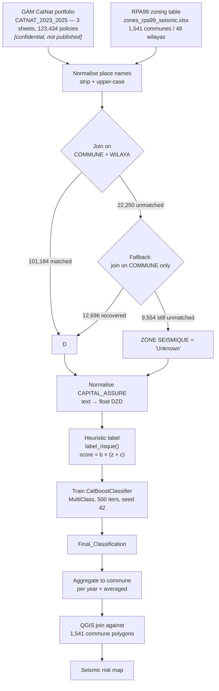
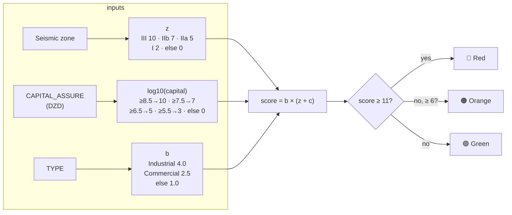

# Methodology

How the pipeline works, why each step is there, and — importantly — what it
does **not** prove.

---

## 1. Objective

Estimate, at policy and commune level, how exposed GAM Assurance's property
portfolio is to earthquake loss, and express it as a three-class risk label
(**Red** / **Orange** / **Green**) that can be mapped geographically and used to
target post-earthquake inspection and reinsurance planning.

---

## 2. Pipeline



---

## 3. Step 1 — Load and concatenate

Each worksheet is read independently and tagged with `Source_Year` taken from
the sheet name, so the pipeline scales to additional years without code changes.
2023 contributes 39,196 records, 2024 40,010, 2025 44,228.

`Source_Year` is kept as a **model feature** because portfolio composition and
risk mix are not identical across the three exercises.

## 4. Step 2 — Join the seismic zoning

Seismic hazard is a property of **location**, so the zone is attached by joining
the policy table to the RPA99 commune table.

Commune names are only unique *within* a wilaya, so the primary join key is the
pair `(COMMUNE, WILAYA)`. Because the GAM export and the RPA99 annex disagree on
case and formatting, both sides are upper-cased and stripped first.

A commune name that fails the strict join is retried on `COMMUNE` alone, using
the first occurrence in the zoning table. This is safe in practice because
fallback is only reached for rows the strict key rejected, and it recovers
12,696 of the 22,250 initially unmatched rows.

## 5. Step 3 — The risk heuristic (`label_risque`)

Every policy receives a label from an expert score. There is no observed
ground-truth loss data in the portfolio, so the labels are **constructed, not
measured**.



**Why multiply?** Industrial buildings are both more vulnerable in an earthquake
and more likely to hold high insured values, so the type factor scales the whole
exposure. A commercial building in Zone III scores `2.5 × 10 = 25` (Red); the
same building in Zone I scores `2.5 × 2 = 5` (Green).

**Why `log10` on capital?** The capital distribution is heavily right-skewed —
the 2023 mean (7.6M DZD) is three times the median (2.5M DZD) and the maximum
(8.4bn DZD) is four orders of magnitude above the median. On a linear scale a
single industrial policy would dominate every other feature. Log-bucketing makes
the capital axis interpretable: each step is a factor of ten.

**Why these thresholds?** They are a judgement call made for this project to
separate the three bands cleanly across the observed data. They are **not**
calibrated against claims history, and no sensitivity analysis was performed.

## 6. Step 4 — CatBoost

```python
CatBoostClassifier(
    iterations=500,
    loss_function="MultiClass",
    verbose=100,
    random_seed=42,
)
```

| Role | Features |
|---|---|
| categorical | `COMMUNE`, `WILAYA`, `ZONE SEISMIQUE`, `TYPE`, `Source_Year` |
| numeric | `CAPITAL_ASSURE` |
| target | `Risque_Color` |

CatBoost was specified by the organisers and is the right tool here: the
`COMMUNE` feature alone has ~1,500 distinct values, and CatBoost consumes
high-cardinality categoricals natively through ordered target statistics — no
one-hot encoding, no target-leakage-prone label encoder. `random_seed=42` makes
the run reproducible.

`Final_Classification` is the model's prediction, written back to the table
alongside the heuristic label.

## 7. Step 5 — Aggregate for mapping

Two commune-level tables are produced for the QGIS join:

* **per year** — `TOTAL_CAPITAL`, `POLICY_COUNT` and the modal risk class within
  each commune-year, which exposes year-on-year concentration shifts;
* **averaged** — `AVG_CAPITAL` (mean capital *per policy*), the modal class over
  the full three-year window, and `YEARS_COUNT` as a completeness flag.

The modal class (`x.mode()[0]`) is used rather than the mean because the target
is nominal, not ordinal.

---

## 8. Known limitations

These are stated plainly because they determine how the results should be read.

### 8.1 The model is not evaluated

**The model is trained and evaluated on the same 123,434 rows.** There is no
train/test split. The training logloss falls from `0.783` at iteration 0 to
`0.000752` at iteration 499, which reflects the model fitting the heuristic
function rather than generalising to unseen data.

Consequently **no accuracy, precision, recall, F1 or confusion matrix is
reported for this project**, because none would be meaningful. Adding a
stratified split is the first item under *Future Improvements* in the README.

### 8.2 The labels are a heuristic, not observed loss

`Final_Classification` is a CatBoost approximation of `Risque_Color`, which is
itself a hand-designed formula. The model reproduces the heuristic; it does not
discover anything the heuristic did not encode, and it is not validated against
claims. The honest framing is *rule-based risk scoring with a learned
surrogate*, not *machine-learned risk prediction*.

### 8.3 Communes that failed to match

| Stage | Rows | Share |
|---|---:|---:|
| Total policies | 123,434 | 100% |
| Matched on `COMMUNE` + `WILAYA` | 101,184 | 82.0% |
| Recovered by `COMMUNE`-only fallback | 12,696 | 10.3% |
| **Unmatched → `Unknown`** | **9,554** | **7.7%** |

Unmatched rows receive `z = 0`, so they can only reach Red through a very high
capital value and the industrial type factor. They are systematically
**under-classified**. The root cause is unreconciled naming: wilaya
abbreviations (`B.B ARRERIDJ`), accented names, and the code-prefixed form found
in the raw workbook. The `COMMUNE CODE` / `WILAYA CODE` integer columns are a
reliable key and were not used for the join.

### 8.4 Zone `0` is scored as `Unknown`

`label_risque` has no branch for zone `'0'`, so the 3,251 Sahara policies fall
into the `else` case and receive `z = 0` — the same weight as an unmatched row.
For zone `0` this is arguably the correct outcome (negligible hazard), but it
means the two cases are indistinguishable in the output.

### 8.5 Other data-quality observations

* **719 duplicate `NUMERO_POLICE` values** within the 2023 sheet alone. If these
  are genuine renewals they are double-counting exposure; if they are export
  artefacts they should be de-duplicated. Unresolved.
* **1 row with a null `COMMUNE` and `WILAYA`** survives grouping and appears in
  the commune summaries as an empty-key row.
* **`TYPE` nulls become the literal string `'nan'`.** `astype(str)` is applied
  before `fillna('Unknown')`, so the `fillna` never fires. Such rows fall
  through to `b = 1.0` (treated as residential), which is a safe default, but the
  `'nan'` string becomes a spurious category for CatBoost.
* **Mixed date formats** (`DD/MM/YYYY` in 2023, ISO in 2024–2025) are left
  unparsed, so the dates are unused rather than wrong.
* **The QGIS project is joined to a stale table** produced by the first
  iteration of the pipeline, on an older four-column schema. See
  [DATA_SOURCES.md](DATA_SOURCES.md) §3.

### 8.6 Deliverables not implemented

The organisers' brief defines four deliverables plus a dashboard. This
repository contains **Deliverable B** in full and **part of Deliverable A**
(QGIS rather than the suggested Folium/Plotly HTML). **Deliverable C (Monte
Carlo catastrophe simulation / PML) and Deliverable D (reinsurance treaty
design), and the final dashboard, are not implemented here.**
